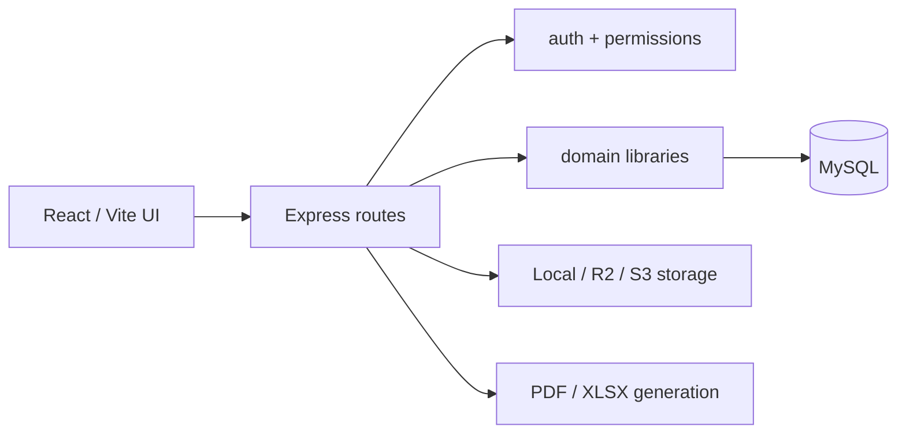

# GKUC SiteOps architecture

## Runtime

The product is one persistent MySQL-backed application. The frontend is React 19/Vite and calls the Express API. In production Express serves the finished frontend bundle. The backend uses ESM, `mysql2`, Zod validation and the AWS S3 SDK for compatible object storage.



## Backend design

- `backend/src/index.js` composes routers, middleware, static serving and scheduled work.
- `backend/src/db.js` owns pooled connections, transactions, password functions and audit logging.
- `backend/src/schema.js` creates tables and performs idempotent additive migrations at startup. Do not add a non-idempotent DDL statement.
- Each `backend/src/routes/*.js` file owns one domain's API. Writes must validate payloads, scope records, enforce permissions and audit before/after data where applicable.
- `backend/src/lib/` contains pure or shared domain logic. Keep calculation logic here, not inside JSX or SQL strings.

## Frontend design

- `frontend/src/main.jsx` is the application shell, navigation and permission-aware routing.
- Pages live in `frontend/src/pages/`; most forms use shared primitives from `frontend/src/ui.jsx`.
- `frontend/src/api.js` is the fetch/session wrapper. Do not bypass it for ordinary API requests.
- Styling is shared in `frontend/src/workspace.css` and page-specific CSS. Keep spacing, cards and button classes consistent with the existing visual language.

## Persistence and audit principles

Business records use MySQL as the source of truth. Payroll, inventory, finance and workflow changes often require transactions because derived totals, allocations and audit records must commit together.

`payroll_policies` are effective-dated and company-scoped. A policy can be archived (`archive_key != 0`) without invalidating foreign keys held by payroll runs, overtime records or claims. The active calculation queries only select `archive_key=0`; history queries may intentionally include archived records.

Saved payslips retain a calculation snapshot. PDF payslips and XLSX exports read that snapshot rather than recalculating from mutable attendance, policy or employee data.

## Authorization

Routes must use the helpers in `backend/src/lib/http.js`:

- `auth` authenticates the session.
- `permit(...)` enforces the server-side permission.
- `validate(...)` validates Zod input.
- `wrap(...)` sends operational errors through the shared error path.

Company selection in the UI is never sufficient authorization. Query and mutation scope must be checked in the route.

## Operational commands

From the repository root:

```bash
npm run build
npm run dev
```

From `backend/`:

```bash
PATH=/Users/thinuladamsith/.nvm/versions/node/v20.12.2/bin:$PATH node --test test/<file>.test.js
npm run payroll:diagnose -- EMPLOYEE_CODE
npm run storage:diagnose:s3
```

Do not use a source change or a local test as evidence that production was deployed. Production changes need an explicit deployment request and a separate before/after verification.

## Fleet asset renewal creation

The Add fleet asset form accepts multiple renewal rows, each with its own type and expiry date. `POST /fleet` accepts an optional non-empty `renewals: [{docType, expiryDate}]` array of distinct supported document types, alongside the legacy `renewal`/`dueDate` fields. The server selects the earliest submitted expiry for the fleet summary and inserts every current document and dated renewal-history record within the asset-creation transaction. Existing single-renewal clients remain supported; no schema migration is needed. Creation audit data includes all submitted renewals. Subsequent changes still use the dated `/fleet/:id/documents` workflow; generic asset PATCH rejects renewal arrays. Existing compliance lists and alerts read the saved document records.

## Optional fuel float and quantity

`POST /fleet/:id/fuel` accepts omitted/null `fuelFloatId` and `litres`. The UI sends the selected operating `companyId`; the API validates it against the selected project and float, if present. Without a float, fuel and odometer records and any project expense still save transactionally, but no petty cash movement/payment is fabricated. With a float, existing balance, locking and company checks remain in force. Records without a float do not appear as petty cash payments in the daily payment report. Company fleet cost reports still include them.

An idempotent startup migration permits NULL in `fuel_records.litres`, preserving existing values and the positive-quantity constraint for supplied values. Unknown quantities display as a dash; vehicle fuel efficiency is unavailable when the measured interval contains an unknown quantity. Aggregate litres represent known quantities only.

## Reference-style client invoice print layout

Invoice preview and PDF share `invoiceDocument` in `backend/src/lib/documents.js`. They retain the saved system letterhead, explicitly show its company-details element when a saved address exists, and use the selected company's existing address from `documentContext`. The invoice body uses boxed date/reference, supplier/purchaser, delivery/place-of-supply and additional-information sections. Missing purchaser TIN is rendered as a dotted write-in space without inventing a tax identifier or changing the database. Saved TINs are printed when present. The bottom includes amount in words and payment mode; net payable is shown separately when it differs from the VAT-inclusive total (deductions, cumulative credits or suspended VAT).

New invoice forms and creation/preview requests default to Reference, Description and Amount columns (Unit, Quantity and Rate off). Existing per-invoice column controls persist choices; legacy records without saved options retain their previous all-column fallback. Column visibility does not change stored quantities, rates or accounting. Hidden Quantity and Rate allow the existing manual lump-sum input workflow. No schema or business-record update is required for this presentation change.

## Client creation from invoices

The client selector in `frontend/src/Receivables.jsx` opens the shared exported `ClientForm` from Client Directory in a modal above the still-mounted invoice workflow. Saving persists through `POST /clients`, adds the returned record to the selector and selects it immediately. Cancelling preserves the invoice and its prior client. Other invoice fields and manual lines remain; selecting the new client resets the old project, paid-invoice credits and project-linked source lines so another client's work is not billed accidentally. Initial client-list loading merges newly created clients to avoid losing a saved selection.

`GET /clients` and `POST /clients` also accept `finance.invoice`, enabling invoice writers to list and create real client records with the same validation, duplicate handling and audit as Client Directory. Editing, archiving and deletion retain `clients.manage`; detailed client-history access is unchanged. No schema change is required.

## Invoices without a named purchaser

The invoice client selector is optional. `POST /receivables/invoices` accepts omitted or null `clientId` for company-level manual invoices and persists `client_id=NULL`, an empty historical `client` name, and null purchaser snapshot fields. No placeholder client is created and no schema change is needed. The operating company remains required; an explicitly supplied invalid client still fails validation. Existing project/quotation billing derives and validates its client as before.

Invoice print/preview renders a dotted purchaser-name space when no name is saved, alongside the existing dotted TIN/address/phone placeholders. Such invoices can be issued and receive payments normally. Previous-invoice credits require an identified saved client in both calculation preview and creation, avoiding accidental pooling of unrelated unnamed purchasers. The ageing table labels empty names as “No client specified”; invoice references remain the record identity.

## Volume units in quotations and invoices

`frontend/src/MeasurementUnit.jsx` supplies common unit suggestions, including Litres and Barrels, while allowing existing/custom unit text. Manual client quotation creation and editing use it, as do invoice lines. Selecting Litres or Barrels on an invoice enables its Unit, Quantity and Rate print columns; the Use quantity × rate action enables them for other units. Existing lump-sum defaults remain available.

Both APIs already persist a string unit and decimal quantity/rate on each line. Amounts continue to use the existing quantity-times-rate calculations, with quotation markup/taxes and invoice taxes/deductions applied normally. A barrel is an independent billing unit: no assumed litre capacity or automatic conversion is introduced. Saved line units and amounts feed previews, printed documents and PDFs; no schema or production data migration is required.

## Remembered scanner names in attendance imports

`employee_biometric_ids.scanner_name` is an optional internal name attached to the employee's existing scanner-number mapping. A guarded additive startup migration adds it without changing existing mappings. The existing manual Match action sends the imported scanner name to `POST /biometric/mappings`; that route saves it in the same audited transaction as the number/employee link. Creating a profile from the scanner also saves its source name. No new fields, screens, confirmation steps or employee display-name changes are introduced.

`backend/src/lib/biometric-identities.js` resolves both preview and commit. Approved scanner numbers still work for older mappings with no saved name. For an unknown number, a previously approved scanner name can identify an employee after case/whitespace normalization; ordinary profile names are not automatically treated as aliases. Duplicate saved names belonging to different employees, conflicting number/name ownership and a name occurring under multiple numbers in the same file require manual decisions rather than guessed name matches. Known approved numbers distinguish employees with the same scanner name. Deactivated scanner codes remain excluded, and deactivated/Left profiles cannot be matched by name. Hidden/Left owners also count toward name ambiguity.

Aliases stay in the employee-linked identity register and audit trail, outside profile display/API data. A deliberate reassignment updates the scanner name with the identity decision (or clears the old name if no replacement is supplied). No import preview writes aliases; normal HR matching remains the approval event. Existing attendance corrections, saved payroll snapshots and calculation policies are unchanged.

## HR special daily pay

`/api/payroll/special-pay` is an authenticated `hr.payroll` module. GET requires a company ID and lists only employees currently in that payroll company. POST `/rules` upserts an employee/effective-date method and fixed agreed rate snapshot; POST `/days` upserts a dated Bass/Gola/Machine/Standby record with source reason. POST `/days/:id/archive` reversibly archives a daily record. Employee visibility/status, work-kind compatibility, real dates and meter/hour validation are enforced server-side. All writes are audited; no supervisor approval is inserted into this workflow.

Two additive, guarded tables hold `employee_special_pay_rules` and `employee_special_pay_days`; they link to existing employees/users and preserve earlier rate/input history in audit logs. No employee is automatically assigned a special method. `frontend/src/pages/SpecialDailyPay.jsx` appears within Payroll Inputs and keeps the existing attendance/import and regular claims workflows intact.

`backend/src/lib/special-pay.js` selects the employee's effective method per work date and produces saved per-day calculation evidence. `attendance-payroll.js` combines it with company-dated policies, month-to-date work counts, ordinary OT/late and the operator exclusions. Payroll generation validates required/orphan inputs, applies the special EPF exception without changing profile data (ETF stays governed by the existing profile/policy), saves operator transport as dated payslip components and allocates special earned basic to project costs. Paid leave snapshots its selected rate. Original/approved payslips remain immutable; exports use saved details via `payslip-detail.js`, including variable/premium daily earnings and machine readings. See `docs/PAYROLL.md` for the exact business rules.

Operator OT eligibility is resolved from the saved, active daily work record in calculation, HR suggestion review and manual OT entry. Standby maps to labour Site OT at the company policy's effective rate with a 30-minute minimum; Machine and missing daily choices cannot enable OT. The pure employee context carries the selected day's input alongside its effective rule. Operator late exclusion remains independent of this day-specific OT eligibility. No schema change is required for the Standby clarification.


## 2026-11-03 — Electron online desktop client

`desktop/` packages the existing React build with Electron 45.2.1. A secure custom
protocol serves local assets and streams same-origin API/upload/share requests to the
configured HTTPS server (default https://staff.gkucconstruction.com). Existing bearer
sessions, server authorization, persistence and SSE remain authoritative; there is no
local database or backend. Sandbox/context isolation remain enabled. The small preload
only exposes connection settings, with writes restricted to the settings page.
Successful live connections resync bootstrap; transient bootstrap failures preserve
authentication. Windows x64 NSIS and macOS arm64 ZIP packaging use electron-builder;
releases are currently unsigned, manually updated and online-only. See
[DESKTOP.md](DESKTOP.md) for build commands, test evidence and rollout limits.

## 2026-11-03 — manual desktop QA corrections

Document previews use a short-lived ticket on the configured network server origin in
an isolated PDF-enabled Electron window. This avoids blank/custom-protocol PDF rendering;
no bearer token is embedded in a URL. QR and Drive public URLs resolve through
`publicAppOrigin` / `usePublicAppOrigin`, so a desktop asset origin is never handed to
another device. The configured HTTPS origin remains authoritative in packaged builds.

`askText` in shared UI replaces native prompt calls with a queued asynchronous in-app
dialog. Drive folder naming, saved finance views, purchasing risk reasons, gallery
withdrawal and subcontractor decisions share this behavior in browser and desktop.
Existing server validation still applies; Cancel does not submit a subcontractor decision.
Optional fuel project, expense category and equipment-service status fields now permit
their existing empty/default options. No backend route, calculation or schema changed.
See MANUAL_QA.md for coverage and DEPLOYMENT.md for rollout/rollback instructions.

### Desktop product identity (2026-11-03)

Electron is branded GKUC Construction with a white-background rings-only native icon.
The application ID and legacy packaged user-data directory remain stable across the
rename. Packaging and regeneration details are in DESKTOP.md. Browser/API branding,
server selection and shared database behavior are unchanged.

### Remembered desktop sessions and document credit (2026-11-04)

`POST /api/auth/login` accepts optional boolean rememberDevice (default false). Existing
hashed sessions/expiry/revocation remain authoritative: remembered sessions expire in
30 days; normal sessions in 12 hours. No new database columns or silent policy writes.
Electron stores only the opaque token+server origin, encrypted through safeStorage,
with atomic queued writes and file mode 0600. Its three session IPC handlers require
the main local top frame; remote PDF/pop-up frames cannot read/write them. Connection
changes clear the encrypted token. Frontend restores it before bootstrap; invalid
sessions/logouts remove both the in-window copy and encrypted copy. Browser behavior
is unchanged. Plaintext OS storage backends are refused.

`developer-credit.js` is the shared mandatory print attribution decorator, used by
common documents, employee letters, payslips and the send/render-PDF fallback. It is
idempotent and independent of configurable company footers. Ordinary documents show
one end credit; payslips use a bottom-centre @page margin credit on every printed page
with existing confidentiality/page-number margins retained. Saved financial payroll
calculations and approved/paid records are not changed. Existing uploaded PDF files
are not rewritten; the rule applies to system-generated documents.

### Task-list status updates (2026-11-04)

Tasks rows expose permitted next statuses directly in their Status column. A short
confirmation form calls the existing PATCH /api/tasks/:id, then reloads shared data.
Blocked/Rejected require a reason; Completed requires management for Approved/Rejected;
Approved status changes require management and a reason (2026-11-04 clarification). Read-only users retain badges. Office and project task groups
share the same control, persisted record, audit history and live update flow as the
detail dialog. No route/schema or permission changes.

### Navigation scroll containment (2026-11-04)

Global root width containment uses overflow-x:clip so sticky desktop navigation and
mobile/tablet header track the viewport. Module layouts no longer disable global
navbar stickiness. A shared workspace-nav-offset clears the global bar for module
and QS section navigation while preserving bounded section-menu scrolling.

### Approved task corrections (2026-11-04)

Management with site.tasks and projects.manage may change Approved tasks to any
non-Approved status through the list or reopen from detail. A reason is mandatory.
PATCH clears approved_by, adds a reason comment and preserves prior approval/change
audit history. Reapproval still requires Completed. Updates compare the previously
read status and reject stale status changes with 409. Other users cannot reopen
approved tasks. This supersedes the earlier Approved-task lock only; payroll approval
locks and financial records are unaffected.

### Per-document quotation/invoice print options (2026-11-04)

Guarded additive JSON print_options columns on quotations_client and client_invoices
store per-record presentation. Shared GET/PUT /api/qs/quotations/:id/print-options
(qs.view/qs.quotation) and /api/receivables/invoices/:id/print-options
(finance.view/finance.invoice) expose authenticated options; writes require the
respective create/edit permission and are transactionally audited as PRINT_OPTIONS.
No prices, totals, payment history or business status is changed.

Quotations may share printedReference across separate work alternatives; original
system references/IDs remain available for record tracing and finance links. The
QS list shows the printed reference plus the record reference when they differ.
Existing quotation revisions already share their system reference; new revisions
also copy print options. Invoice printed-reference overrides are rejected.

Shared rendering removes selected cells/sections, corrects column spans and hides
all total summaries/category totals/amount-in-words when totals are off. Choices
include letterhead fields, unit/quantity/rate/line amounts, parties/work details,
notes/methods/terms/bank/signatures/company footer. Mandatory developer credit is
independent. Existing NULL settings retain legacy output/identity/column choices.
Invoice options and the older columns endpoint are synchronized; previous-invoice
credit snapshots are preserved. Progress-claim invoice PDFs read the same options.

### Fleet vehicle details editing (2026-11-05)

Fleet vehicle cards expose View / edit details. Transport managers can use Edit vehicle
details to update name, registration/asset ID, status, make, model, year, engine code
and manual/service notes through the existing audited `PATCH /fleet/:id` route.
Vehicle names and registrations are trimmed and validated; duplicate registrations
return 409 without saving other edits. Driver/site assignments, odometer readings
and renewal dates retain their dated, history-preserving workflows. No schema change.

### Petty cash funding affordance (2026-11-05)

Account create/edit no longer requires the warning threshold in the browser; blank
maps to the existing lowAt=0 API default. Account ledgers expose Add money / Top up,
preselecting the existing Top up movement kind. The same persisted entries endpoint
and ledger-derived balance are used for all account categories; no schema, permission
or accounting rule change.

### Reviewed bond workbook import (2026-11-05)

Finance Bonds uses `GET /receivables/bonds/import/template`, multipart `POST
/receivables/bonds/import/preview` and `POST /receivables/bonds/import/:id/submit`.
All require finance.invoice. The additive bond_import_batches table stores uploader,
company, source checksum, review JSON and completion status. Preview changes no bonds;
submit validates reviewed rows and saves all register changes/audit entries atomically.
Uploader ownership, company/project checks, snapshot conflicts, duplicate target/number
checks and completed-batch/checksum checks prevent stale and repeated imports. Existing
reference and extension history are preserved. See [bond import](BOND_IMPORT.md).

### Linked historical workbook imports (2026-11-05)

Import centre detects controlled Clients/Contacts, Projects/Project Team and BOQ
Headers/Items .xlsx workbooks before the generic/free-layout import path. Source IDs
resolve through historical_import_links across files; child rows have composite source
keys. Review mode linked-workbook supports corrections, explicit existing client/project
links and source employee mapping through PATCH /import-centre/batches/:id/linked-review.
Confirmation rechecks under transactional batch/dependency locks, persists parent/child
records, source_json and audits atomically, and skips already imported source keys.
BOQs stay Draft and never implicitly change approved budgets. Contact records persist
in client_contact_people and are returned by the client detail API/profile. Guarded
column widening preserves long project/BOQ names and descriptions. See
[Historical imports](HISTORICAL_IMPORTS.md) for validation, ordering and source caveats.

### Project deadlines and extension request letters (2026-11-05)

Project creation/editing accepts a nullable end date. Optional dates can be added later;
later changes to an existing end date use the audited extension workflow. Guarded
project_extensions and projects.extension_count persist repeat extensions and immutable
letter HTML. Project view/manage routes expose history and saved letter/PDF, with explicit
PDF-ticket path authorization. POST extension locks/checks the current date and atomically
saves dates, letter and audits. Company changes are blocked once extensions exist.
Project cards/workspace derive Completed > Extended > Current and offer search/status/
manager/date filters. The existing scheduler/bootstrap run a calendar-month deadline
scan for all active users; delivery keys dedupe per project/end-date/user/day and stop
for Completed/inactive records. Recurring reminders create no escalation cases. See
[Project deadlines](PROJECT_DEADLINES.md) for operational and client-request semantics.

### Editable PO documents and commercial revisions (2026-11-05)

Existing purchasing orders now support manual/generated editable numbers, per-document
presentation and multi-line calculated/manual amounts. PUT /purchasing/orders/:id saves
reasoned optimistic revisions transactionally; /check and /revisions support review/history.
Existing receive/invoice/payment endpoints remain the financial owners. Receipt unit rates
and cumulative received value prevent retroactive valuation when current PO prices change;
supplier invoices retain approved-PO snapshots for their original obligations. Supplier
statements and payment matching read these values. Commercial revisions reset approvals,
including preventing self-approval by the revision author. Guarded schema additions and
append-only revision records preserve auditability; received quantity/identity and linked
supplier/project accounts remain protected. PO PDF tickets and Materials deep links are
explicitly supported. See [Purchase orders](PURCHASE_ORDERS.md).

### Existing vehicle record actions (2026-11-05)

Fleet vehicle cards expose direct Edit details and Add renewal actions. The detail
modal places editing, driver, odometer, fuel, service/repair, schedule and renewal
controls before its summaries and history. These use the existing authorized,
persistent Fleet endpoints for both existing and newly created vehicles. Identity
edits remain separate from dated operational and renewal history.

### Restored feature access (2026-11-06)

Removed the temporary feature middleware, shared pause configuration, simulated OS/driver
notices and dashboard warning. Finance, QS, Projects and People mount their normal
operational components again. Bootstrap BOQs, project BOQ/invoice/expense/cost details,
client invoice history and historical BOQ imports use their existing permissions and
company scope without artificial suppression. API routes and document tickets retain
normal authentication, authorization and validation. No schema or saved data changes.
See TEMPORARY_FEATURE_PAUSE.md for the superseded pause history and rollout limits.

### Financial statement views (2026-11-09)

Finance → Financial reports includes Statement of Financial Position and Income Statement.
`GET /api/finance/financial-statements?companyId=…&period=YYYY-MM` requires auth and
`finance.reports`, validates company/month and uses company-scoped saved management
sources. `financial-statements.js` owns presentation calculations; optional expense-source
selection in `managementPack` leaves existing closed-pack payloads unchanged. No schema
or write endpoint is added. These are live monthly internal views, separate from closed
management-pack snapshots. Financial position is cumulative through month end; income
is for that month. The statement controls deliberately use company/month, not the
project/date filters of the other reports. CSV includes basis and unknown-value labels.
See [FINANCIAL_STATEMENTS.md](FINANCIAL_STATEMENTS.md) for calculation/coverage limits.

### Cross-company supplier cheques and funding visibility (2026-11-09)

Issued-cheque selection loads the selected supplier's invoices across both operating
companies and labels each invoice's owner. `POST /purchasing/cheques` accepts mixed-company
invoices for one supplier; `PATCH` clearing retains the supplier, reservation, remaining
balance, transactional rollback and idempotency checks. The cheque's company is the payer;
invoice ownership never changes. Additive nullable `supplier_payments.payment_company_id`
records that payer at clearance. Cash comparison, daily payments, reporting supplier cash
and management-pack cash follow the payment company (legacy nulls use invoice company),
while invoice/payable reconciliation follows invoice ownership. Legacy cheque ownership
backfill only touches records without a modern invoice-total snapshot, preserving new
single-invoice cross-company cheques across startup. Ordinary invoice lists/statements
and cheque registers retain their company filters. No intercompany journals are created.

Expenses' daily API additionally returns read-only `fundingEntries` and `fundingTotal`
from existing dated petty-cash Top up rows, including opening funding, for every account
type and selected company/day. The Expenses page shows a separate Petty cash funding
table with location/search/method filters and live-change refresh. Funding is excluded
from payment/expense totals and profitability; no duplicate expense record or posting is
created. Subsequent spending retains existing single-cost recognition. Petty-cash form
copy explains this visibility and links through the existing account-ledger workflow.


### Operator Machine-day payroll evidence (2026-11-09)

`operatorPayrollDays` in special-pay.js prepares payroll-only daily evidence before
leave/attendance calculation in payroll generation. Effective Machine operator + active
Machine meter input can supply a worked date without saved attendance. Other missing
operator dates become payroll-only Absent from join date, with normal approved leave
handling retained. Actual attendance takes precedence; explicit absence/leave conflicts
with machine inputs block review. Standby cannot substitute for attendance. Calendar
month preparation preserves extra-day premium counting. No schema or attendance write
is introduced. Payslip source snapshots identify derived evidence and its daily-input ID;
existing save/exports and Approved/Paid immutability apply. See PAYROLL.md.

### Planning-only expected-outflow worksheet and bond project selection (2026-11-09)

Expected outflows now uses `/finance/expected-outflows/worksheet?companyId&from&to`.
The display sums only saved standalone open cash_outflow_plans in the selected date
range; linked operational forecasts remain available through the legacy endpoint but
are not injected into the manual worksheet. Additive company_office persists each
row's company/office description. POST `/expected-outflows/plans/batch` validates up
to 100 rows and company/project scope and transactionally saves all rows/audits or none.
Existing details/status endpoints support edits and reversible archive; no expense,
income, invoice, payment or bank-ledger write occurs from planning actions.

`outflow_worksheet_periods` stores a manually entered bank_balance per exact company/
From/To range, separately from cash-comparison and real bank reconciliation. Balance
writes are audited. The worksheet reads client receivable balances and supplier/bill
outstanding automatically across all dates, deducting all recorded payments. Only
manual cash-outflow rows are date-filtered; receivable/payable schedules remain current
company balances independent of From/To. These separate schedules are not added
to manually entered outflow totals. Prior overdue items outside From are excluded.
Current cancellations remain authoritative; this is a live planning view, not a
closed historical accounting snapshot.

The worksheet document route uses shared sendDocument/PDF generation and an exact
short-lived PDF-ticket allowlist with From/To parameters. PDF includes company, the selected period,
manual bank balance, all three schedules, totals and mandatory developer credit. Per user
request PDF headings/notes do not explain which schedule the date filter applies to.
All routes require auth + finance.expectedOutflows. Frontend supports bulk rows, edits,
archive and PDF preview/download/print; exports contain saved records only.

Bootstrap full project rows now include companyId alongside company_id; finance.invoice
also receives minimal active-project choices when it lacks projects.view. Bond Project
selection accepts both field shapes for older-server compatibility and retains company
scope/current saved selection. Bond lists emphasize linked project name or saved tender/
project description, with actual bank bond number secondary; system references remain
stored/searchable for audit/import linking but are not the list's displayed title.

### One shared Retention workspace in QS and Finance (2026-11-09)

`frontend/src/pages/Retention.jsx` owns the existing QS summaries/table, creation form
and release form. Both QS → Retention and Finance → Retention render that exact shared
component with the selected company/projects and identical operations; the Record
retention action is inside the shared workspace. No Finance-specific API, table, sync
job or copied retention record is created. Existing `/qs/retentions` GET/POST and release
POST remain authoritative, with project-owned company scope and existing audit/history.
Read permits qs.view, finance.view, qs.retention or finance.manage; writes permit
qs.retention or finance.manage. UI capabilities mirror those write permissions.
Read-only users cannot create/release. Bootstrap includes minimal project choices for
retention/finance managers without broader project view; forms accept both company field
shapes and show only the selected company's projects. Existing records/IDs and releases
are shared across entry points, not migrated or duplicated. No schema change.

### BOQ financial adjustments and import review (2026-11-09)

`boq-financials.js` validates/calculates independent subtotal percentages and fixed LKR
Add/Deduct rows. Nullable guarded boqs.financial_adjustments persists entered values;
boq_imports.financial_adjustments and adjustments_reviewed persist staged proposals and
confirmation. Create, detail, document, item-add and approved item-change paths share the
calculation, preserving existing approval/budget behavior and direct-edit locks. Item
addition recalculates in one transaction. Existing BOQs with no adjustments are unchanged.

The workbook parser scans all sheets, including the new optional template Adjustments
sheet; PDF text/OCR parser detects common labelled tax/deduction lines separately from
priced work. Staging retains source references, excludes matching summary work rows,
requires saved financial review and locks import status at commit to avoid a second BOQ.
Metadata/review edits are audited. Flexible Import Centre document review reuses the
editor, validation and BOQ storage. Linked historical multi-BOQ identity/declared-total
imports remain a separate contract. No automatic VAT/retention/payment posting is added.
See [BOQ financial adjustments](BOQ_FINANCIALS.md) for bases, examples and parser limits.

### HR-earned labour allocation to BOQ items (2026-11-09)

Cost Control can allocate one employee's worked day across multiple BOQ items. The
server reads saved HR attendance and the effective payroll rules for the work date, or
the immutable Approved/Paid payslip detail where it exists. It derives earned daily pay
as basic earnings plus approved OT minus late deductions, divides that by worked hours,
and persists each BOQ allocation's hours and calculation snapshot on `daily_cost_lines`.
The submission transaction recalculates the amount and rejects allocations beyond the
employee's recorded hours, duplicate legacy full-day entries, payroll allocations, and
attendance requiring HR review. Finance approval continues to post the saved line cost.

### Direct office payment categories (2026-11-09)

The Daily Expenses direct-office-payment form reads the existing Finance expense-category
register and stores the selected category name on the separate office payment record.
It does not create a project expense or alter existing category records.


## 2026-11-09 — invoice source documents and statement ranges

Client invoice entry groups existing project item sources by BOQ/quotation ID. Quotation
sources include Sent and Accepted; Draft/Declined/Expired remain excluded. BOQs retain
the Approved requirement and transactionally locked remaining-quantity cap. Source
rates remain server-resolved, including quotation markup. Source requests clear stale
results on project changes and ignore responses after selection changes. Item links
persist in client_invoice_items as before; no extra receivable or mirrored document.
Invoice-specific bankDetails is validated and saved inside invoice_options; an explicit
empty string suppresses company bank defaults, while legacy/null options retain them.
The shared print renderer suppresses duplicate letterhead date/reference, enlarges the
title, splits comma-delimited addresses, places the work title immediately before the
items table and confines additional information to saved user notes. Place of supply
continues to accept a manually entered saved value, with the existing blank-site fallback.

GET /finance/financial-statements accepts companyId plus inclusive from/to dates (legacy
period remains supported). managementPack receives optional bounds only for this view;
monthly close APIs retain calendar-month behavior. Income/cost uses those dates; balances
include earlier records and only receipts/payments through To. Monthly management
adjustments apply in full for months touched, explicitly disclosed because no daily
adjustment date is stored. Unknown balance-sheet accounts remain unknown. Authenticated
GET /finance/financial-statements/document uses the same data and finance.reports permission
and shared sendDocument PDF generator, including the mandatory Infinity AI end credit.
The UI offers From/To, CSV and authenticated PDF download; no ticket or public URL needed.

## 2026-11-09 — shared quotation/invoice authoring and creator signatures

`QuotationIdentityChoices.jsx` is shared by QS and Finance. The identity/presentation
schema and snapshot helpers are extracted to `quotation-presentation.js` without changing
QS contracts. Finance can read saved company bank accounts, work methods and quotation
note templates; write/admin permissions remain unchanged. New authenticated
GET /receivables/invoice-identity allows an optional purchaser. Invoice creation validates
company bank ownership and saves presentation, user-entered terms/payment terms/additional
notes and per-line category/reference/method text in existing invoice_options JSON.
No arbitrary markup is added to invoices: existing server-owned source rates and saved
invoice totals/deductions remain authoritative.

`invoiceDocument` adapts saved invoice data into `quotationDocument`, retaining its
letterhead, identity blocks, subject, priced table, methods, terms, bank section and
first-page-only letterhead. Invoice totals are injected from the saved invoice snapshot,
including cumulative credits; quotation arithmetic cannot replace them. Exempt invoices
use Subtotal/Total Value; tax invoices retain VAT working. Signature/footer/Infinity AI
credit are grouped to avoid an orphan footer. Presentation flags remain effective.
Normal, tax, billing-term and progress-certificate receivables snapshot the actual
creator's user ID/name/account role in invoice_options.creator. Client-provided preparer
names are ignored. The document route uses this immutable snapshot; legacy records use
the linked created_by account, never the printing user. Existing quotations' selectable
preparer behavior and payment-request letter behavior are unchanged.

## 2026-11-09 — atomic project company ownership synchronization

PATCH /projects/:id retains projects.manage and validates the active destination company.
With the project locked, `moveProjectCompany` synchronizes explicit company_id registers
(tasks, fleet fuel/maintenance/readings, income, bills, inquiries, quotations, tenders,
client invoices/plans, received cheques, bonds, dedicated floats, subcontract quotations,
management adjustments and outflow plans), plus supplier invoices through project POs
and quotation-linked billing records. Project-only BOQs, costs, files and operations
inherit ownership through their existing project IDs. Same-company saves run the same
repair, supporting projects already moved by older code. Each changed ownership and
document snapshot is audited in the same transaction. A destination unique-key conflict
returns 409 and rolls everything back; stale project-company edits are rejected.

Saved quotation/invoice issuer presentation switches to the destination company. Source
bank instructions/account IDs are cleared instead of choosing a new bank account by
assumption; originals remain in audit history. Original document numbers, amounts,
statuses, attachments, creator identity and payroll snapshots are retained. Shared cash
accounts and employee payroll companies are not reclassified. Actual supplier payer is
fixed in payment_company_id before invoice ownership moves; issued-cheque payer remains
unchanged. Startup legacy cheque backfill no longer overwrites a known payer. The
feature performs no background/live database repair: the updated application must be
released, then an authorized user saves the affected project.

## 2026-11-09 — supplier direct and petty-cash batch payments

POST /purchasing/supplier-payments/batch requires finance.pay. Up to 100 distinct invoice
allocations must share the selected company and supplier. Amounts are positive cents.
Independent no-PO approval/three-way matching and recent supplier-bank verification still
apply. Invoice locks serialize payments; active cheque allocations reserve balances.
A selected expense float must be active, belong to that company, have sufficient balance
and satisfy a dedicated-project restriction. Salary-advance floats cannot fund suppliers.

Additive supplier_payment_batches stores a unique client reference and request hash.
Same-user identical retries return the saved batch; a changed request rejects reuse.
Nullable supplier_payments.batch_id and unique petty_cash_entry_id link each settlement
to its batch and one signed cash movement. Validation, invoice balances, supplier payment,
float debit and audits commit atomically. No second project expense is inserted.
Daily Expenses, Cash Comparison and management cash totals omit linked supplier rows
because the petty movement already represents the outflow; payable balances still use
all supplier payments. Statements label linked settlements as Petty cash. Existing
single-invoice direct API and Issued cheques remain available. Credit-purchase UI exposes
Pay alongside review actions and Pay supplier with selection/select-all, partial amounts,
source/account and one total. Required reviews remain enforced by the server.

## 2026-11-09 — create materials within Site Today

`MaterialForm.jsx` is extracted from Materials and reused by Site Today. Its existing
POST /materials and PATCH /materials/:id contracts, validation and store.manage permission
are unchanged. Optional onCreated and repeat props let Site Today close after one save,
merge the returned record into its picker and append one zero-usage draft row. Existing
Materials create/edit and repeat-entry behavior is retained. The local picker also keeps
new records if the shared bootstrap refresh fails; a save is not retried for refresh
failure. Functional draft updates preserve work/attendance/other material values and
prevent adding the same material twice. No new schema, route or company scoping is added:
materials remain shared catalogue records. Creation is unavailable offline, during loading/
sync and on a synced report; existing offline draft editing remains supported. Store
opening stock is not treated as issued site stock, and existing site consumption checks
remain authoritative. Site reporters without store.manage can still choose saved materials
but do not receive master-data creation permission through this page.

## 2026-11-09 — daily cost sheet PDFs and Vehicle costs

GET /boq/cost-control/daily-sheets/document?projectId=ID exports all saved project sheets,
without the Cost Control screen's recent-row limit. GET /boq/cost-control/daily-sheets/:id/
document exports one sheet. Both share existing sheet read permissions and require an
active project; company identity is resolved from that project. `daily-cost-document.js`
reads saved sheet/line amounts, statuses, work-task links, resources and review notes.
PDF summary splits Approved/Submitted/Returned costs and approved quoted recovery, followed
by category summary, sheet register and per-sheet detail. Proposals are not presented as
posted actuals; quoted recovery is explicitly not a receipt or booked revenue. No export
writes, approvals or recomputation from current rates. Shared sendDocument/Infinity AI
credit and narrowly whitelisted ticket paths power normal browser/Electron preview,
download and print. Output is landscape A4 with repeated table headings and row protection.

Vehicle is added to daily_cost_lines.source through guarded modifyColumn and the default
expense.source option. Expenses already store source as VARCHAR, so no expense-table
migration is needed. Manual Vehicle lines require an existing active fleet vehicle;
Excel review can select a vehicle for Vehicle rows and import persists the same FK.
Finance approval posts the saved Vehicle amount once using the existing expense origin,
without manufacturing Fuel, maintenance, cash or vehicle-odometer transactions. Historical
categories and amounts are not reclassified. Fuel retains its separate controlled route.
Vehicle costs are included as direct project costs in Income Statement presentation.

## 2026-11-09 — VAT calendar-quarter countdown

VAT Ledger uses `vat-quarter.js` to derive the calendar quarter containing the selected
To date, displaying quarter label, quarter end and nonnegative calendar days remaining.
On the final day it says Ends today; past quarters say Quarter ended. Default quarter
and current date use Asia/Colombo explicitly. The open view refreshes that business date
every minute. UTC-midnight date arithmetic avoids browser time-zone/DST day fractions.
This is a quarter-end display only, independent of filing/payment due dates, VAT rates,
filing status and saved reconciliation. Custom date ranges do not redefine quarter end.
No VAT record, tax amount, deadline or notification is created or changed.

### 2026-11-10 — attendance site departure and split OT

Additive guarded attendance.site_stop TIME and raw_punches JSON columns retain the three-punch boundary and scanner evidence. Attendance single/bulk/PATCH, bootstrap and employee history expose siteStop; biometric preview/commit carry siteStop and punchTimes. Exactly three punches provide a candidate middle boundary, with raw punches visible in import review. Shared site-travel-ot.js supplies independent Site/Travel suggestions to payroll and HR review. Payroll inputs accept a reviewed overtimeType; input_detail retains actualMinutes when a rounded displayed suggestion is accepted, preserving exact-minute pay. Draft approval checks saved blocking warnings without recalculating approved history. Payslip and workbook exports read saved source/calculation details. Existing auth, audit, import correction protection and effective-dated policy scope remain.

Split automatic OT is grouped into one Attendance OT project-cost allocation per source attendance ID, summing Site and Travel while retaining separate payslip details. This preserves the unique source audit key and prevents duplicate source allocations.

### 2026-11-10 — audited fingerprint identity correction

The biometric router registers correction handlers from `lib/biometric-correction.js`: GET `/biometric/correction-mappings`, GET `/biometric/corrections/history`, POST `/biometric/corrections/preview` and POST `/biometric/corrections/commit`; all require `hr.attendance`. Preview validates source/target/scanner ownership, returns provenance-qualified attendance, target conflicts, affected payroll/HR inputs and a SHA-256 state digest. Commit locks mappings, companies, employees and attendance, rechecks the digest, validates selected records/decisions and requires a reason plus applicable legacy/saved-payroll acknowledgements. New minimal profiles are created only within the successful transaction; no salary/other employment data is copied.

Additive attendance.biometric_code records the actual scanner export code on future imports. Legacy Biometric rows with no code are candidates requiring explicit verification, while other known device codes and manual rows are excluded. Nullable identity_archived_at and identity_archived_employee_id preserve conflict alternatives: archiving retains the entire row/ID, original employee and timestamps while clearing employee_id to release the active employee/day uniqueness slot. visible_attendance excludes these archives; biometric legacy adoption also excludes them. No attendance is hard-deleted. Per-row before/after audit records and batch decisions preserve history, available from the correction screen.

Mapping reassignment preserves the scanner-name alias and corrects its owner and primary legacy biometric_id fields. Import commits lock mappings before employees and reject changed ownership. Both profiles' overlapping Draft payslips receive a blocking saved warning until explicit regeneration. Approved/Paid snapshots, historical allocations, reviewed OT, leave, claims and site-cost records remain unchanged; UI identifies separate HR review requirements. This workflow uses shared employee identities and each selected profile's existing payroll company, without transferring company finances.

## 2026-11-10 — shared petty floats and linked MD personal spending

Petty cash floats are now shared resources rather than company-owned payment accounts. Active float lists and Fuel/QS/supplier account selection span both companies; each ledger's total SUM(amount) remains authoritative. `petty_cash_floats.company_id` is retained as legacy creation/opening-funding provenance, not an access/spending scope. Project-company transfers and startup project synchronization no longer rewrite it. Guarded `petty_cash_entries.company_id` and its foreign key persist the paying/funding company per movement; legacy NULL values are backfilled from the float's previous company attribution, without changing amounts/dates. Report fallbacks support older integrations, while all application-created entries now save an explicit company. Legacy callers omitting companyId retain the float's old default; the updated UI always selects it. Salary advances require the employee's pay company; existing daily limits and payroll recovery remain.

Ledger entry creation, opening funding, Fleet fuel, QS station purchases and supplier batch payments all save entry company. Fleet/QS fuel records also save their actual payment company immediately. Daily Expenses/funding, Finance reporting, Cash comparison and management cash projections scope individual entries, not float owners; supplier and fuel/project mirrors are still counted once. A default project is a convenience only; each normal payment must match its selected company's project. The updated form explicitly submits no project for office spending. Shared scopes are displayed in Finance.

Nullable unique petty entry client_ref and request_hash allow safe movement retries; same-user identical requests replay, changed requests fail. Existing float locks and insufficient-funds checks remain transactional. Office direct payments keep their unique company/reference guard and now use one transaction for payment, optional personal metadata and audit.

`md_personal_expenses` holds category/notes and exactly one original petty_cash_entry_id or office_payment_id, with unique source links and foreign keys. Amount/date/payer/payee/reference/recorded-by are read from that payment, never duplicated as another expense. Its router is installed beneath `/finance`: GET `/md-personal-expenses`, `/payments`, `/document`, `/export.xlsx`; POST `/link`; PUT `/:id` for category/notes. All require `finance.manage`. Existing petty entry and office payment APIs accept mdPersonal/personalCategory/personalNotes to link atomically. Personal petty cash must be an unallocated Office expenses spend, not fuel, payroll, supplier settlement or an already-posted project cost. No personal project-cost row is generated. Existing payments can be linked without changing their cash movement. No repayment/debt model is created.

Private receipt attachments add md_personal_expense to the guarded owner enum, owner table, storage folders and Finance-management read/write policies. PDF uses the existing protected renderer/developer credit and a narrowly whitelisted download ticket with validated filters; Excel reads the same filtered register. UI lives in MdPersonalExpenses.jsx, linked at the bottom of Finance's grouped sidebar, with date/company/source/category filters, company/category summaries, new/existing payment actions, metadata editing and receipt details. Access still follows server permissions; sharing a float does not make supplier invoices or project costs cross-company.

The personal register also stores an optional paid_by name independently of the original recorded-by audit user. Category, notes and paid-by can be corrected without altering the source payment amount/date.

## 2026-11-10 — consolidate old petty floats

`petty-cash-merge.js` registers POST `/receivables/petty-cash/merge/preview` and `/commit`, both requiring finance.manage. Validated distinct active IDs must share an account type. Preview returns individual balances/counts and an account/entry state digest. Commit locks accounts and entries in ID order, rechecks state, freezes any legacy company attribution, records historical entry membership, reassigns source entries to the chosen target and archives sources. No top-up/spend/adjustment, payment or expense is created. User, reason, before/after settings and redirects are audited. Client reference and request hash make retries replay safely. Changed requests, stale previews, closed accounts, category mixing and cycles are rejected.

Additive fields preserve merged destination/date/balance on floats and first original_float_id on entries. `petty_cash_float_merges` stores audited batches; `petty_cash_float_merge_entries` preserves each operation's original membership. Repeated merges flatten destination pointers while retaining historical membership; archived ledgers remain readable without including later destination spending. Active balance queries read each current entry once, while company reports use the preserved per-entry company. GET `/receivables/petty-cash?includeMerged=1` exposes archived account metadata; the existing entries route includes archived membership, first origin name and existing linked records. Writes/edits to archived accounts remain blocked.

PettyCashMerge.jsx provides choose/preview/confirm, explicit combined name/reason and stale-preview recovery. Archived cards show the destination and balance at merge, with read-only history and Open shared account. Pending QS station-fuel choices resolve historical float IDs to their current active destination on validation/review, retaining the saved original selection and creating any new actual payment on the destination only. Entry IDs and fuel/supplier/MD/payroll recovery foreign keys are unchanged. No automatic consolidation or live merge occurs from a code change.

The float entries API supports a validated beforeDate/beforeId cursor with stable descending date/ID ordering. FloatLedger loads 300 rows at a time and appends older history, so merging does not make older records inaccessible through the existing first-page limit.

### Retention remarks

The shared Finance and QS Retention screen displays the existing retention notes as remarks. Users with `qs.retention` or `finance.manage` can add, edit, or clear a remark through `PATCH /qs/retentions/:id/remark`, including after release. The endpoint updates the notes field and records the change in the same transaction. A release with a blank remark keeps the saved text.

### Vehicle fuel submission and approval

The authenticated `/fuel-submissions` API stores company-scoped submissions, optional project references and optional private photo metadata. A recorder with `fuel.submit` can choose shared active vehicles and view their own submissions. Department read access and `fuel.view` expose the shared queue. `fuel.review` allows approval or rejection by a user other than the submitter. The Fuel Recorder role is provisioned once with submit access and can be edited through Access Control.

Approval locks the submission and uses the same posting transaction as direct Fleet fuel entry. The actual odometer reading is required before posting. One approval creates one fuel record and odometer reading, with a project expense or a shared Fuel float movement when the corresponding selection applies. Rejections preserve a reason and history. Project-linked submissions move with the project on company transfer. Photos are served through the authorized submission route using the configured local or object storage driver.

### Personal reminders

The authenticated `/reminders` API stores one-time reminders and individual recipient records. The recipient directory exposes active account names and IDs. Only the creator and selected recipients can read a reminder. Dashboard lists reminders addressed to the signed-in user.

The alert scheduler checks due times every minute. It records one targeted in-app notification per recipient and marks that recipient notified in the same transaction. The realtime event goes to that recipient, and unread reminder notifications persist in the bell for users who were signed out. Due times are stored in UTC and entered and displayed in Sri Lanka time.
