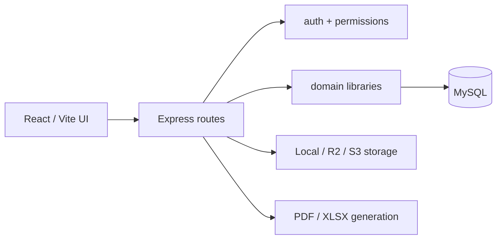

# GKUC SiteOps architecture

## Runtime

The product is one persistent MySQL-backed application. The frontend is React 19/Vite and calls the Express API. In production Express serves the finished frontend bundle. The backend uses ESM, `mysql2`, Zod validation and the AWS S3 SDK for compatible object storage.



## Backend design

- `backend/src/index.js` composes routers, middleware, static serving and scheduled work.
- `backend/src/db.js` owns pooled connections, transactions, password functions and audit logging.
- `backend/src/schema.js` creates tables and performs idempotent additive migrations at startup. Do not add a non-idempotent DDL statement.
- Each `backend/src/routes/*.js` file owns one domain's API. Writes must validate payloads, scope records, enforce permissions and audit before/after data where applicable.
- `backend/src/lib/` contains pure or shared domain logic. Keep calculation logic here, not inside JSX or SQL strings.

## Frontend design

- `frontend/src/main.jsx` is the application shell, navigation and permission-aware routing.
- Pages live in `frontend/src/pages/`; most forms use shared primitives from `frontend/src/ui.jsx`.
- `frontend/src/api.js` is the fetch/session wrapper. Do not bypass it for ordinary API requests.
- Styling is shared in `frontend/src/workspace.css` and page-specific CSS. Keep spacing, cards and button classes consistent with the existing visual language.

## Persistence and audit principles

Business records use MySQL as the source of truth. Payroll, inventory, finance and workflow changes often require transactions because derived totals, allocations and audit records must commit together.

`payroll_policies` are effective-dated and company-scoped. A policy can be archived (`archive_key != 0`) without invalidating foreign keys held by payroll runs, overtime records or claims. The active calculation queries only select `archive_key=0`; history queries may intentionally include archived records.

Saved payslips retain a calculation snapshot. PDF payslips and XLSX exports read that snapshot rather than recalculating from mutable attendance, policy or employee data.

## Authorization

Routes must use the helpers in `backend/src/lib/http.js`:

- `auth` authenticates the session.
- `permit(...)` enforces the server-side permission.
- `validate(...)` validates Zod input.
- `wrap(...)` sends operational errors through the shared error path.

Company selection in the UI is never sufficient authorization. Query and mutation scope must be checked in the route.

## Operational commands

From the repository root:

```bash
npm run build
npm run dev
```

From `backend/`:

```bash
PATH=/Users/thinuladamsith/.nvm/versions/node/v20.12.2/bin:$PATH node --test test/<file>.test.js
npm run payroll:diagnose -- EMPLOYEE_CODE
npm run storage:diagnose:s3
```

Do not use a source change or a local test as evidence that production was deployed. Production changes need an explicit deployment request and a separate before/after verification.
