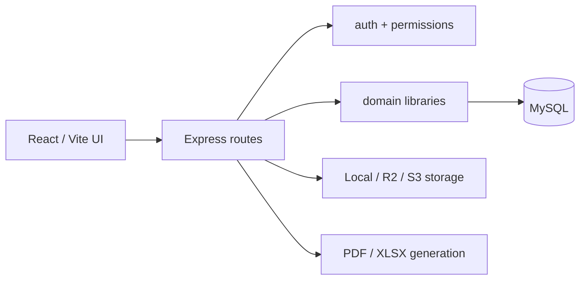

# GKUC SiteOps architecture

## Runtime

The product is one persistent MySQL-backed application. The frontend is React 19/Vite and calls the Express API. In production Express serves the finished frontend bundle. The backend uses ESM, `mysql2`, Zod validation and the AWS S3 SDK for compatible object storage.



## Backend design

- `backend/src/index.js` composes routers, middleware, static serving and scheduled work.
- `backend/src/db.js` owns pooled connections, transactions, password functions and audit logging.
- `backend/src/schema.js` creates tables and performs idempotent additive migrations at startup. Do not add a non-idempotent DDL statement.
- Each `backend/src/routes/*.js` file owns one domain's API. Writes must validate payloads, scope records, enforce permissions and audit before/after data where applicable.
- `backend/src/lib/` contains pure or shared domain logic. Keep calculation logic here, not inside JSX or SQL strings.

## Frontend design

- `frontend/src/main.jsx` is the application shell, navigation and permission-aware routing.
- Pages live in `frontend/src/pages/`; most forms use shared primitives from `frontend/src/ui.jsx`.
- `frontend/src/api.js` is the fetch/session wrapper. Do not bypass it for ordinary API requests.
- Styling is shared in `frontend/src/workspace.css` and page-specific CSS. Keep spacing, cards and button classes consistent with the existing visual language.

## Persistence and audit principles

Business records use MySQL as the source of truth. Payroll, inventory, finance and workflow changes often require transactions because derived totals, allocations and audit records must commit together.

`payroll_policies` are effective-dated and company-scoped. A policy can be archived (`archive_key != 0`) without invalidating foreign keys held by payroll runs, overtime records or claims. The active calculation queries only select `archive_key=0`; history queries may intentionally include archived records.

Saved payslips retain a calculation snapshot. PDF payslips and XLSX exports read that snapshot rather than recalculating from mutable attendance, policy or employee data.

## Authorization

Routes must use the helpers in `backend/src/lib/http.js`:

- `auth` authenticates the session.
- `permit(...)` enforces the server-side permission.
- `validate(...)` validates Zod input.
- `wrap(...)` sends operational errors through the shared error path.

Company selection in the UI is never sufficient authorization. Query and mutation scope must be checked in the route.

## Operational commands

From the repository root:

```bash
npm run build
npm run dev
```

From `backend/`:

```bash
PATH=/Users/thinuladamsith/.nvm/versions/node/v20.12.2/bin:$PATH node --test test/<file>.test.js
npm run payroll:diagnose -- EMPLOYEE_CODE
npm run storage:diagnose:s3
```

Do not use a source change or a local test as evidence that production was deployed. Production changes need an explicit deployment request and a separate before/after verification.

## Fleet asset renewal creation

The Add fleet asset form accepts multiple renewal rows, each with its own type and expiry date. `POST /fleet` accepts an optional non-empty `renewals: [{docType, expiryDate}]` array of distinct supported document types, alongside the legacy `renewal`/`dueDate` fields. The server selects the earliest submitted expiry for the fleet summary and inserts every current document and dated renewal-history record within the asset-creation transaction. Existing single-renewal clients remain supported; no schema migration is needed. Creation audit data includes all submitted renewals. Subsequent changes still use the dated `/fleet/:id/documents` workflow; generic asset PATCH rejects renewal arrays. Existing compliance lists and alerts read the saved document records.

## Optional fuel float and quantity

`POST /fleet/:id/fuel` accepts omitted/null `fuelFloatId` and `litres`. The UI sends the selected operating `companyId`; the API validates it against the selected project and float, if present. Without a float, fuel and odometer records and any project expense still save transactionally, but no petty cash movement/payment is fabricated. With a float, existing balance, locking and company checks remain in force. Records without a float do not appear as petty cash payments in the daily payment report. Company fleet cost reports still include them.

An idempotent startup migration permits NULL in `fuel_records.litres`, preserving existing values and the positive-quantity constraint for supplied values. Unknown quantities display as a dash; vehicle fuel efficiency is unavailable when the measured interval contains an unknown quantity. Aggregate litres represent known quantities only.

## Reference-style client invoice print layout

Invoice preview and PDF share `invoiceDocument` in `backend/src/lib/documents.js`. They retain the saved system letterhead, explicitly show its company-details element when a saved address exists, and use the selected company's existing address from `documentContext`. The invoice body uses boxed date/reference, supplier/purchaser, delivery/place-of-supply and additional-information sections. Missing purchaser TIN is rendered as a dotted write-in space without inventing a tax identifier or changing the database. Saved TINs are printed when present. The bottom includes amount in words and payment mode; net payable is shown separately when it differs from the VAT-inclusive total (deductions, cumulative credits or suspended VAT).

New invoice forms and creation/preview requests default to Reference, Description and Amount columns (Unit, Quantity and Rate off). Existing per-invoice column controls persist choices; legacy records without saved options retain their previous all-column fallback. Column visibility does not change stored quantities, rates or accounting. Hidden Quantity and Rate allow the existing manual lump-sum input workflow. No schema or business-record update is required for this presentation change.

## Client creation from invoices

The client selector in `frontend/src/Receivables.jsx` opens the shared exported `ClientForm` from Client Directory in a modal above the still-mounted invoice workflow. Saving persists through `POST /clients`, adds the returned record to the selector and selects it immediately. Cancelling preserves the invoice and its prior client. Other invoice fields and manual lines remain; selecting the new client resets the old project, paid-invoice credits and project-linked source lines so another client's work is not billed accidentally. Initial client-list loading merges newly created clients to avoid losing a saved selection.

`GET /clients` and `POST /clients` also accept `finance.invoice`, enabling invoice writers to list and create real client records with the same validation, duplicate handling and audit as Client Directory. Editing, archiving and deletion retain `clients.manage`; detailed client-history access is unchanged. No schema change is required.

## Invoices without a named purchaser

The invoice client selector is optional. `POST /receivables/invoices` accepts omitted or null `clientId` for company-level manual invoices and persists `client_id=NULL`, an empty historical `client` name, and null purchaser snapshot fields. No placeholder client is created and no schema change is needed. The operating company remains required; an explicitly supplied invalid client still fails validation. Existing project/quotation billing derives and validates its client as before.

Invoice print/preview renders a dotted purchaser-name space when no name is saved, alongside the existing dotted TIN/address/phone placeholders. Such invoices can be issued and receive payments normally. Previous-invoice credits require an identified saved client in both calculation preview and creation, avoiding accidental pooling of unrelated unnamed purchasers. The ageing table labels empty names as “No client specified”; invoice references remain the record identity.

## Volume units in quotations and invoices

`frontend/src/MeasurementUnit.jsx` supplies common unit suggestions, including Litres and Barrels, while allowing existing/custom unit text. Manual client quotation creation and editing use it, as do invoice lines. Selecting Litres or Barrels on an invoice enables its Unit, Quantity and Rate print columns; the Use quantity × rate action enables them for other units. Existing lump-sum defaults remain available.

Both APIs already persist a string unit and decimal quantity/rate on each line. Amounts continue to use the existing quantity-times-rate calculations, with quotation markup/taxes and invoice taxes/deductions applied normally. A barrel is an independent billing unit: no assumed litre capacity or automatic conversion is introduced. Saved line units and amounts feed previews, printed documents and PDFs; no schema or production data migration is required.

## Remembered scanner names in attendance imports

`employee_biometric_ids.scanner_name` is an optional internal name attached to the employee's existing scanner-number mapping. A guarded additive startup migration adds it without changing existing mappings. The existing manual Match action sends the imported scanner name to `POST /biometric/mappings`; that route saves it in the same audited transaction as the number/employee link. Creating a profile from the scanner also saves its source name. No new fields, screens, confirmation steps or employee display-name changes are introduced.

`backend/src/lib/biometric-identities.js` resolves both preview and commit. Approved scanner numbers still work for older mappings with no saved name. For an unknown number, a previously approved scanner name can identify an employee after case/whitespace normalization; ordinary profile names are not automatically treated as aliases. Duplicate saved names belonging to different employees, conflicting number/name ownership and a name occurring under multiple numbers in the same file require manual decisions rather than guessed name matches. Known approved numbers distinguish employees with the same scanner name. Deactivated scanner codes remain excluded, and deactivated/Left profiles cannot be matched by name. Hidden/Left owners also count toward name ambiguity.

Aliases stay in the employee-linked identity register and audit trail, outside profile display/API data. A deliberate reassignment updates the scanner name with the identity decision (or clears the old name if no replacement is supplied). No import preview writes aliases; normal HR matching remains the approval event. Existing attendance corrections, saved payroll snapshots and calculation policies are unchanged.

## HR special daily pay

`/api/payroll/special-pay` is an authenticated `hr.payroll` module. GET requires a company ID and lists only employees currently in that payroll company. POST `/rules` upserts an employee/effective-date method and fixed agreed rate snapshot; POST `/days` upserts a dated Bass/Gola/Machine/Standby record with source reason. POST `/days/:id/archive` reversibly archives a daily record. Employee visibility/status, work-kind compatibility, real dates and meter/hour validation are enforced server-side. All writes are audited; no supervisor approval is inserted into this workflow.

Two additive, guarded tables hold `employee_special_pay_rules` and `employee_special_pay_days`; they link to existing employees/users and preserve earlier rate/input history in audit logs. No employee is automatically assigned a special method. `frontend/src/pages/SpecialDailyPay.jsx` appears within Payroll Inputs and keeps the existing attendance/import and regular claims workflows intact.

`backend/src/lib/special-pay.js` selects the employee's effective method per work date and produces saved per-day calculation evidence. `attendance-payroll.js` combines it with company-dated policies, month-to-date work counts, ordinary OT/late and the operator exclusions. Payroll generation validates required/orphan inputs, applies the special EPF exception without changing profile data (ETF stays governed by the existing profile/policy), saves operator transport as dated payslip components and allocates special earned basic to project costs. Paid leave snapshots its selected rate. Original/approved payslips remain immutable; exports use saved details via `payslip-detail.js`, including variable/premium daily earnings and machine readings. See `docs/PAYROLL.md` for the exact business rules.

Operator OT eligibility is resolved from the saved, active daily work record in calculation, HR suggestion review and manual OT entry. Standby maps to labour Site OT at the company policy's effective rate with a 30-minute minimum; Machine and missing daily choices cannot enable OT. The pure employee context carries the selected day's input alongside its effective rule. Operator late exclusion remains independent of this day-specific OT eligibility. No schema change is required for the Standby clarification.


## 2026-11-03 — Electron online desktop client

`desktop/` packages the existing React build with Electron 45.2.1. A secure custom
protocol serves local assets and streams same-origin API/upload/share requests to the
configured HTTPS server (default https://staff.gkucconstruction.com). Existing bearer
sessions, server authorization, persistence and SSE remain authoritative; there is no
local database or backend. Sandbox/context isolation remain enabled. The small preload
only exposes connection settings, with writes restricted to the settings page.
Successful live connections resync bootstrap; transient bootstrap failures preserve
authentication. Windows x64 NSIS and macOS arm64 ZIP packaging use electron-builder;
releases are currently unsigned, manually updated and online-only. See
[DESKTOP.md](DESKTOP.md) for build commands, test evidence and rollout limits.

## 2026-11-03 — manual desktop QA corrections

Document previews use a short-lived ticket on the configured network server origin in
an isolated PDF-enabled Electron window. This avoids blank/custom-protocol PDF rendering;
no bearer token is embedded in a URL. QR and Drive public URLs resolve through
`publicAppOrigin` / `usePublicAppOrigin`, so a desktop asset origin is never handed to
another device. The configured HTTPS origin remains authoritative in packaged builds.

`askText` in shared UI replaces native prompt calls with a queued asynchronous in-app
dialog. Drive folder naming, saved finance views, purchasing risk reasons, gallery
withdrawal and subcontractor decisions share this behavior in browser and desktop.
Existing server validation still applies; Cancel does not submit a subcontractor decision.
Optional fuel project, expense category and equipment-service status fields now permit
their existing empty/default options. No backend route, calculation or schema changed.
See MANUAL_QA.md for coverage and DEPLOYMENT.md for rollout/rollback instructions.

### Desktop product identity (2026-11-03)

Electron is branded GKUC Construction with a white-background rings-only native icon.
The application ID and legacy packaged user-data directory remain stable across the
rename. Packaging and regeneration details are in DESKTOP.md. Browser/API branding,
server selection and shared database behavior are unchanged.

### Remembered desktop sessions and document credit (2026-11-04)

`POST /api/auth/login` accepts optional boolean rememberDevice (default false). Existing
hashed sessions/expiry/revocation remain authoritative: remembered sessions expire in
30 days; normal sessions in 12 hours. No new database columns or silent policy writes.
Electron stores only the opaque token+server origin, encrypted through safeStorage,
with atomic queued writes and file mode 0600. Its three session IPC handlers require
the main local top frame; remote PDF/pop-up frames cannot read/write them. Connection
changes clear the encrypted token. Frontend restores it before bootstrap; invalid
sessions/logouts remove both the in-window copy and encrypted copy. Browser behavior
is unchanged. Plaintext OS storage backends are refused.

`developer-credit.js` is the shared mandatory print attribution decorator, used by
common documents, employee letters, payslips and the send/render-PDF fallback. It is
idempotent and independent of configurable company footers. Ordinary documents show
one end credit; payslips use a bottom-centre @page margin credit on every printed page
with existing confidentiality/page-number margins retained. Saved financial payroll
calculations and approved/paid records are not changed. Existing uploaded PDF files
are not rewritten; the rule applies to system-generated documents.
